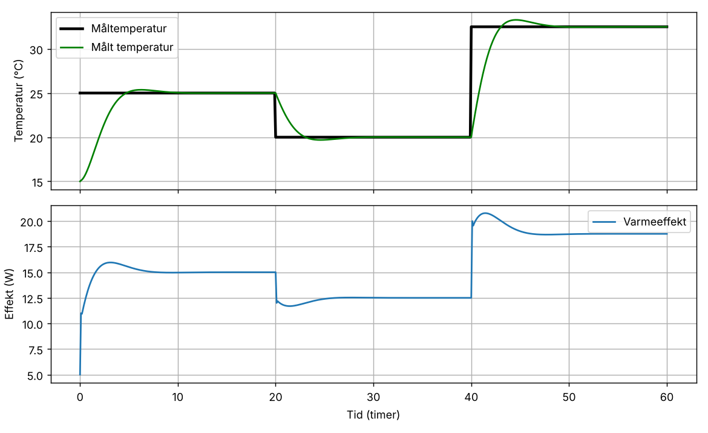

# PID-regulator for romtemperatur

En simulering i Python av en PID-regulator som styrer en varmeovn for å holde temperaturen i et rom på et ønsket nivå. Rommet er modellert som et førsteordens system som taper varme til omgivelsene, og regulatoren justerer varmeeffekten ut fra avviket mellom målt og ønsket temperatur.

<p align="center">
  
</p>

## Resultater

Simuleringen kjører i 60 timer der måltemperaturen endres i tre trinn: 25 °C, 20 °C og 32,5 °C. Utetemperaturen er −5 °C og rommet starter på 15 °C.

- **Ingen varig avvik.** Etter hvert trinn stabiliserer temperaturen seg på måltemperaturen, med avvik under 0,01 °C. Det er integralleddet som fjerner det stasjonære avviket.
- **Lite oversving.** Største oversving er rundt 0,8 °C, ved hoppet til 32,5 °C.
- **Effekten følger varmetapet.** Jo høyere måltemperatur, jo mer effekt trengs for å holde den: rundt 15 W ved 25 °C og 19 W ved 32,5 °C.

## Metode

**Rommodell.** Temperaturen endrer seg med tilført effekt minus varmetap til omgivelsene, diskretisert med Euler-metoden:

$$T_{k+1} = T_k + \Delta t \left( u_k - \frac{T_k - T_{\text{ute}}}{\tau} \right)$$

der $\tau$ er tidskonstanten til rommet.

**Regulator.** Varmeeffekten $u_k$ er en grunneffekt pluss tre ledd basert på avviket $e_k = T_{\text{mål}} - T_k$:

$$u_k = u_0 + K_c \left( e_k + \frac{1}{T_i} \sum_{j \le k} e_j \Delta t + T_d \frac{e_k - e_{k-1}}{\Delta t} \right)$$

- **P-leddet** reagerer på nåværende avvik.
- **I-leddet** summerer avviket over tid og fjerner varig avvik.
- **D-leddet** reagerer på hvor raskt avviket endrer seg og demper oversving.

Standardparametere: $K_c = 0{,}5$, $T_i = 1$, $T_d = 0{,}01$, $\tau = 2$ og $\Delta t = 0{,}1$ timer.

## Filer

```
├── ControllSystem.py      # ControlSystem-klassen og interaktiv meny
├── flowchart.drawio       # flytskjema for programmet
└── simulering.png         # bilde av simuleringen
```

## Kjøring

```bash
pip install numpy matplotlib
python ControllSystem.py
```

Programmet har en meny der du kan sette måltemperatur og starteffekt, kjøre simuleringen og plotte resultatet. Parameterne kan endres i `ControlSystem`-klassen.

## Forfatter

Eirik Aarrestad – bachelor i statistikk og data science, UiB
